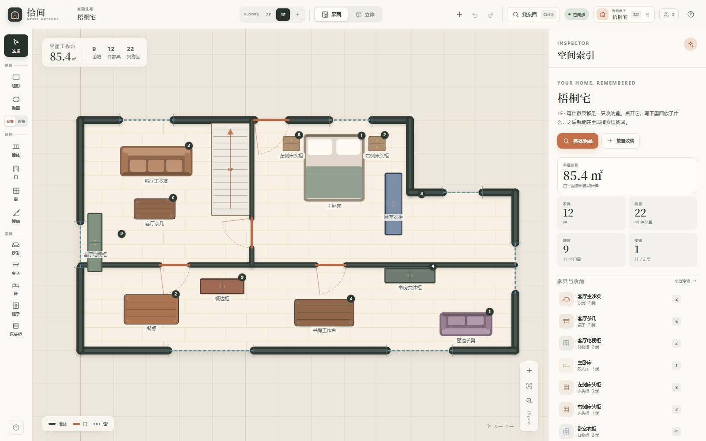
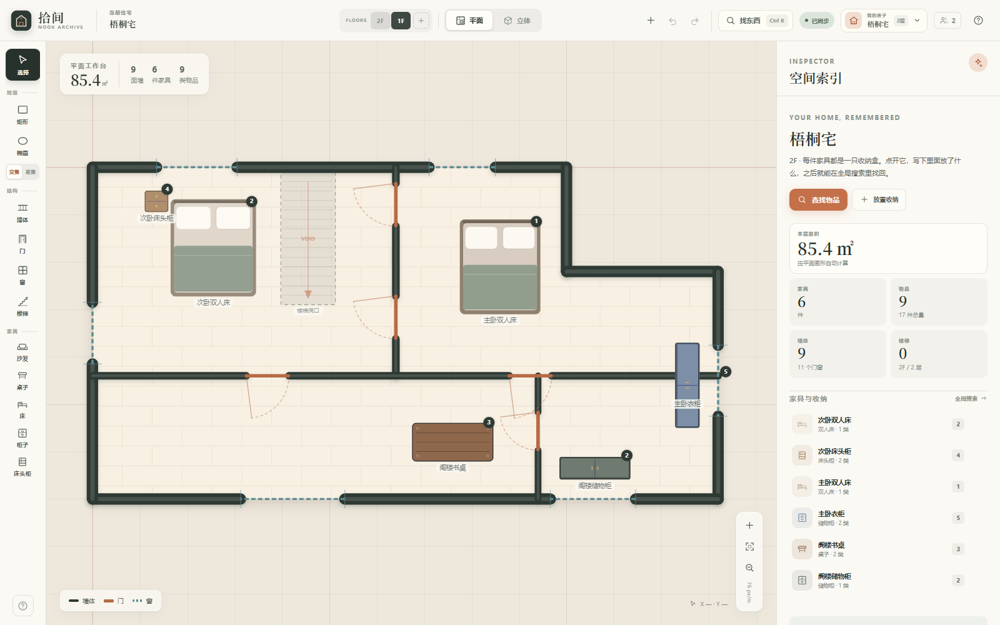
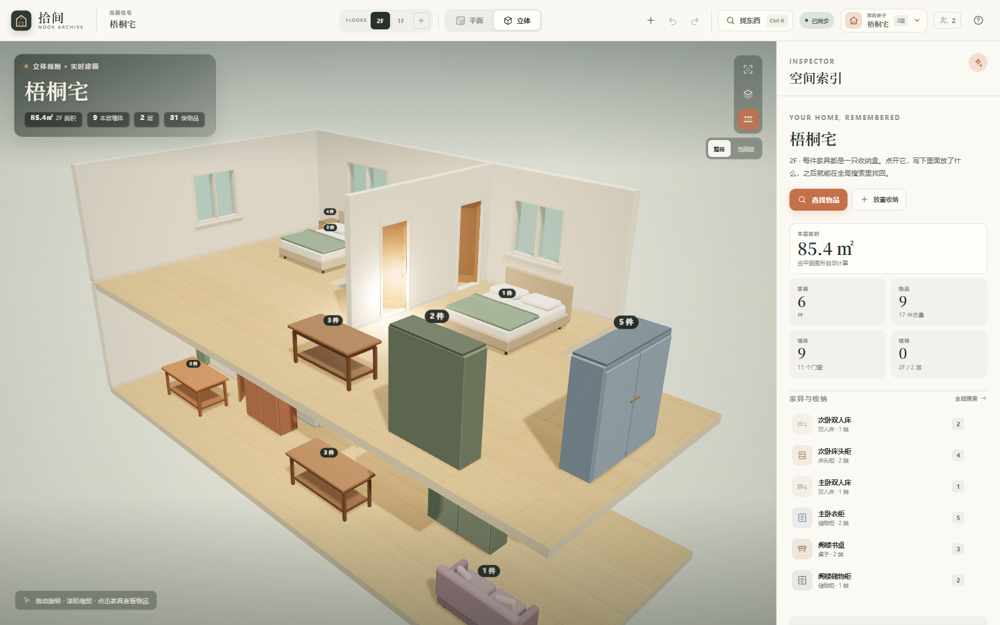
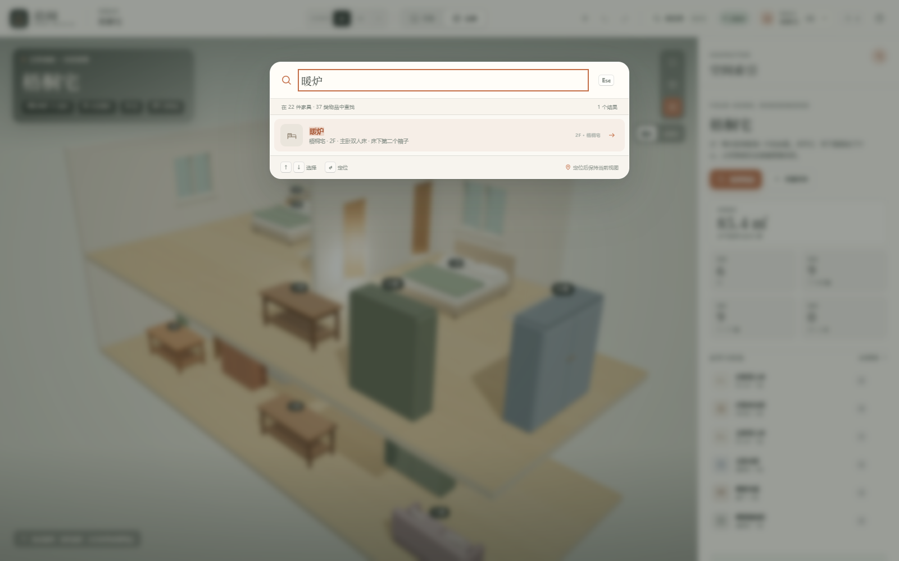
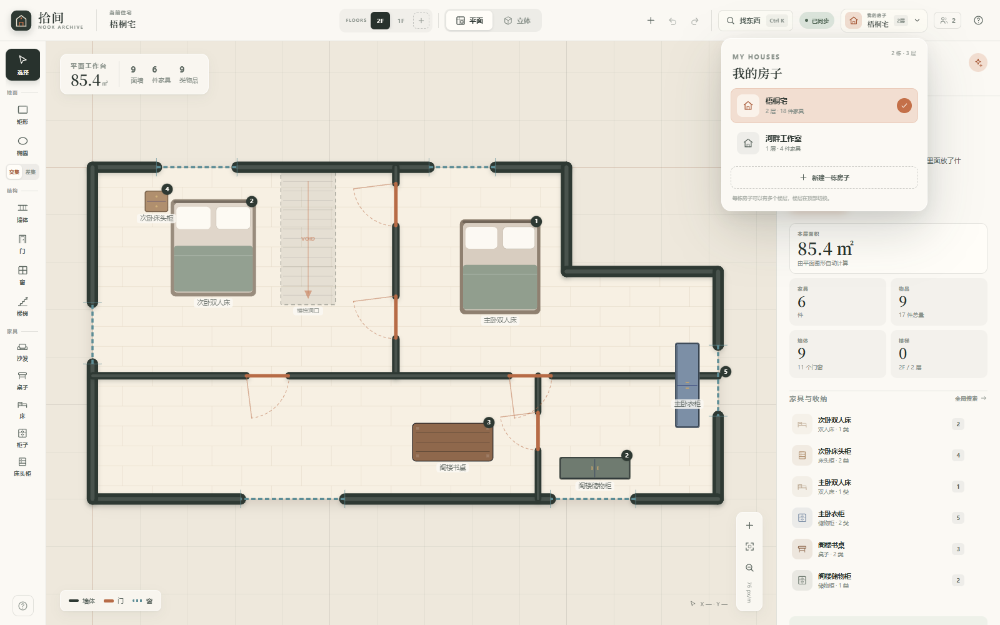

# 拾间 · Where Did I Put Them

一个用平面图搭建住宅、自动生成 Three.js 立体模型，并为每件家具记录内部物品的居家建模工作台。

- **多住宅**：工作区可以保存多栋房子，右上角「我的房子」切换
- **多楼层**：每栋房子可以有多层，顶层自动挖出楼梯洞口
- **楼梯**：平面绘制踏步、UP 箭头，3D 自动生成踏步、扶手和楼层连接
- **后端**：Fastify + TypeScript + WebSocket，JSON 文件持久化
- **前端**：Vue 3 + TypeScript + Three.js + Canvas 2D
- **工程**：pnpm workspace monorepo，tsdown 打包，共享领域模型与几何算法
- **发布**：`wdipt` npm CLI，一条命令启动完整应用











## 功能

### 1. 多住宅与多楼层

- 右上角「我的房子」菜单可以新建、切换多栋独立住宅；每栋房子有自己的名称、楼层、家具和物品。
- 每栋房子支持最多 16 层，顶部楼层条可以切换、复制或新建楼层，也可以删除当前层并重新编号。
- 顶部楼层条显示所有楼层，当前楼层高亮；切换到某一层即编辑该层平面。
- 楼梯工具位于左侧结构栏，也可以按 `S`；楼梯默认连接上一层，在上层地板自动开洞。

### 2. 平面模式

- 矩形 / 椭圆地面画笔，按顺序执行 **交集（融合）** 与 **差集（挖除）**。
  - 交集：新图形并入已有地面，形成 L 形、曲线边等复合轮廓。
  - 差集：从已有地面中挖掉新图形，可做天井、凹口、开放走廊。
- 地面使用 `polygon-clipping` 做真实多边形布尔运算，不是简单叠加图层。
- **墙体**：拖动绘制实线墙体，端点吸附已有墙角，`Shift` 锁定 15° 角度。
- **门**：在墙上点击放置，使用粗实线 + 开启弧表示。
- **窗**：在墙上点击放置，使用青色虚线表示。
- **楼梯**：点击放置踏步与 UP 箭头；可在属性面板调整宽、深、踏步数和朝向，画布上可拖动。
- 门窗沿墙定位，宽度、位置可继续调整；墙体开洞会同步到 3D。
- 家具：沙发、桌子、双人床、储物柜、床头柜。放置后可拖动、水平/垂直移动、旋转、改尺寸、改材质色。
- 64 px/m 起步的缩放画布，滚轮缩放、空格拖拽平移、一键适配、实时面积统计。
- 撤销 / 重做（80 步）、新建住宅、快捷键。

### 3. 立体模式

- 地面按平面轮廓挤出为木地板，支持带孔洞的多边形；上层地板会在楼梯位置自动开洞。
- 多楼层按层高 2.85 m 垂直堆叠，可以在「整栋 / 当前层」之间切换查看。
- 墙体按门窗洞口自动切分为墙段、门楣、窗台和窗楣。
- 门包含门框、门扇、把手，默认开启 90°；窗包含玻璃、窗框、窗楣与窗台。
- 楼梯自动生成踏步、扶手和栏杆，楼梯洞口贯穿到上一层。
- 家具自动生成低多边形模型，尺寸和颜色来自平面对象；台面、床品、柜门、把手等细节为程序化建模。
- 近处外墙/隔墙自动剖切，方便俯视查看室内；右上角按钮可关闭剖切。
- 拖动环绕、滚轮缩放、点击家具直接打开物品详情。
- 搜索定位时显示脉冲光环、光柱与空间标签，并自动把相机移向目标。

### 4. 物品数组与检索

- 每件家具都拥有 `items: StoredItem[]`，记录名称、数量、备注。
- 右侧 Inspector 可直接编辑；点击物品旁的定位按钮，会在当前视图中高亮所在家具。
- `Ctrl / ⌘ + K` 打开全局搜索，检索物品名、备注和家具名。
- 点击结果：
  - 自动切换到对应住宅和楼层，选中并展开对应家具；
  - 平面视图移动镜头并画出脉冲位置环；
  - 立体视图显示光环、光柱与「物品名 · 家具名」标签。
- 结果高亮关键词，支持方向键选择、回车定位、Esc 关闭。

### 5. 实时协同

- 所有修改经 450ms 防抖后通过 WebSocket 发给服务端。
- 服务端校验并规范化工作区数据，写入 `apps/server/data/workspace.json`，再广播给其他窗口。
- 保存中 / 已同步 / 仅本机 / 同步异常状态实时显示。
- WebSocket 不可用时回退到 `PUT /api/workspace`；断线后自动重连。
- 多窗口同时编辑采用最后写入优先；本地未发送的修改会显示提示并继续保存。

## 快速开始

要求 Node.js >= 20、pnpm 11。

```bash
pnpm install
pnpm dev
```

`pnpm dev` 先构建 shared，然后使用 pnpm 自带的 `--parallel` 同时启动 Fastify（tsx watch）和 Vite，不依赖 concurrently。

- 前端：<http://localhost:5173>
- 后端：<http://127.0.0.1:8787>
- WebSocket：`ws://127.0.0.1:8787/ws`（开发环境由 Vite 代理）

首次启动会自动生成两栋示例住宅：「梧桐宅」包含 2 层、楼梯、31 类物品和完整门窗；「河畔工作室」是一层带弧形采光的工作室。可以直接切换楼层、进入 3D 或开始新建自己的房子。

### 生产构建

```bash
pnpm build
pnpm start
```

`pnpm build` 由 `scripts/build.ts` 编排：shared → web → `wdipt`（tsdown），最后把 `apps/web/dist` 复制进 `apps/server/dist/web`，验证 CLI shebang、bin 配置与静态资源后再结束。

访问 <http://127.0.0.1:8787>。Fastify 会同时提供 API、WebSocket 和打包后的静态资源。

可用环境变量：

| 变量 | 仓库内默认值 | npm CLI 默认值 | 说明 |
| --- | --- | --- | --- |
| `PORT` | `8787` | `8787` | 服务端口 |
| `HOST` | `0.0.0.0` | `0.0.0.0` | 监听地址 |
| `DATA_DIR` | `apps/server/data` | `~/.wdipt` | 项目 JSON 目录 |
| `WEB_DIST` | `apps/web/dist` | 包内 `dist/web` | 前端静态资源目录 |

### npm 命令 `wdipt`

`apps/server` 已配置为可发布的 `wdipt` 包，产物包含后端 bundle 和前端静态资源。

```bash
# 发布前先构建并检查 tarball（输出到 release/）
pnpm pack:npm

# 登录 npm 后真正发布
pnpm publish:npm
```

发布后用户可以：

```bash
npx wdipt
# 或
npm install -g wdipt
wdipt --port 9000
wdipt --data-dir ./my-home-data
wdipt --help
```

`wdipt` 会解析 `--port`、`--host`、`--data-dir`、`--web-dist`，也支持对应的环境变量。首次运行在 `~/.wdipt` 生成示例项目。默认监听 `0.0.0.0`；如果只想在本机使用，可加 `--host 127.0.0.1`。

## 快捷键

| 快捷键 | 操作 |
| --- | --- |
| `V` | 选择 / 拖动家具 |
| `R` | 矩形地面 |
| `O` | 椭圆地面 |
| `W` | 墙体 |
| `D` | 门 |
| `N` | 窗 |
| `S` | 楼梯 |
| `Shift + 拖动` | 正方形 / 圆形地面，或 15° 角度锁定 |
| `空格 + 拖动` | 平移画布 |
| `Ctrl / ⌘ + K` | 全局查找物品 |
| `Ctrl / ⌘ + Z` | 撤销 |
| `Ctrl / ⌘ + Shift + Z` | 重做 |
| `[` / `]` | 旋转选中家具 ±7.5° |
| `Delete` | 删除选中对象 |
| `0` | 平面视图适配画布 |
| `Esc` | 取消绘制 / 关闭弹层 / 取消选中 |

## 目录结构

```text
.
├── apps
│   ├── server                 # wdipt CLI：Fastify + WebSocket + JSON 持久化
│   │   ├── src
│   │   │   ├── cli.ts         # bin 入口、参数解析、--help / --version
│   │   │   ├── start.ts       # 启动、端口识别、优雅退出
│   │   │   ├── app.ts         # 路由、静态资源、WebSocket hub
│   │   │   ├── store.ts       # 原子写入与版本递增
│   │   │   └── validation.ts  # 网络输入规范化
│   │   └── tsdown.config.ts   # 后端 bundle 配置与依赖内联
│   └── web                    # Vue 3 前端
│       └── src
│           ├── components     # 顶栏、房子菜单、楼层条、2D 画布、3D 场景、Inspector、搜索
│           ├── lib
│           │   ├── plan.ts    # Canvas 2D 渲染、楼梯与命中测试
│           │   ├── realtime.ts# WebSocket 同步与 HTTP 回退
│           │   └── three      # 多层场景、楼梯、房屋、家具、程序化纹理
│           └── stores         # 工作区、楼层、物品与撤销栈
├── packages
│   └── shared                 # 类型、几何布尔、家具目录、演示数据、搜索
├── scripts                    # TypeScript 构建/打包/发布脚本
│   ├── build.ts               # shared → web → wdipt，并复制前端资源
│   ├── package.ts             # npm pack / publish，校验 tarball
│   └── lib                    # 子进程与构建辅助
├── docs                       # 预览图
└── package.json
```

## 数据模型

```ts
interface Workspace {
  schemaVersion: 2;
  id: string;
  revision: number;
  updatedAt: string;
  houses: House[];
}

interface House {
  id: string;
  name: string;
  floors: FloorPlan[];
}

interface FloorPlan {
  id: string;
  name: string;             // "1F" / "2F"
  level: number;            // 0-based
  shapes: FloorShape[];     // 有序的地面布尔操作
  walls: Wall[];
  openings: Opening[];      // 通过 wallId + offset 嵌入墙体
  furniture: Furniture[];   // 每件家具都有 items
  stairs: Stair[];
}

interface StoredItem {
  id: string;
  name: string;
  quantity: number;
  note: string;
}
```

坐标单位为米。平面坐标 `(x, y)` 映射到 Three.js 的 `(x, z)`，旋转角度取反；楼层高度为 2.85 m。

### 几何流水线

1. 每个 `FloorShape` 转为世界坐标多边形环（椭圆用 64 段离散）。
2. 按顺序用 `union` / `difference` 合并成 `MultiPolygon`，保留孔洞。
3. 2D 使用 `Path2D` + `evenodd` 填充和贴图木纹；3D 使用 `THREE.Shape` + `ExtrudeGeometry` 挤出。
4. 墙体按门窗区间切段，分别生成下墙、门楣、窗台、窗楣。
5. 楼层按 2.85 m 层高堆叠；楼梯踏步从本层升至上一层，上层地板在楼梯足迹位置挖洞。
6. 家具从同一数据模型程序化生成，不依赖外部 3D 资产。

## WebSocket 协议

连接 `/ws` 后发送 `hello`：

```json
{ "type": "hello", "clientId": "client_xxx" }
```

服务端返回：

```json
{ "type": "welcome", "workspace": {}, "clients": 2 }
```

保存时发送完整工作区快照：

```json
{
  "type": "workspace:update",
  "clientId": "client_xxx",
  "requestId": "save_12",
  "workspace": {}
}
```

服务端写入后向发送方回 `workspace:ack`（revision、updatedAt），向其他客户端广播 `workspace:updated`。另有 `presence`、`ping` / `pong` 和 `error` 消息。

完整工作区快照适合当前规模（多栋房子、多层，约几十 KB），避免了复杂 CRDT；服务端负责版本递增与最后写入优先。

## REST API

| 方法 | 路径 | 说明 |
| --- | --- | --- |
| `GET` | `/api/health` | 健康状态、客户端数、房屋/楼层数、当前 revision |
| `GET` | `/api/workspace` | 读取整个工作区 |
| `PUT` | `/api/workspace` | 校验并保存工作区，广播给 WebSocket 客户端 |
| `GET` | `/api/search?q=护照` | 跨住宅、楼层的物品检索 |

## 测试与构建

```bash
pnpm typecheck   # 三个 workspace 包 + scripts TypeScript 类型检查
pnpm test        # 共享几何/多楼层 11 项 + 服务端 API 5 项
pnpm build       # shared(tsdown) -> web(vite) -> wdipt(tsdown) -> 装配 CLI
pnpm pack:npm    # 构建、打包并校验 npm tarball
```

`tsdown` 只安装在仓库根目录，workspace 包通过 pnpm 的 root bin 解析执行。后端 bundle 会内联 `@shijian/shared` 与 `polygon-clipping`，外部化 Fastify / ws 等 npm 运行时依赖。

测试覆盖：

- 矩形融合、带孔差集、空集合差集、椭圆面积误差；
- 楼梯洞口对上层地板的减法；
- 门窗沿墙定位、门楣与窗台保留；
- 多住宅 / 多楼层演示数据与楼梯数据；
- 跨住宅、跨楼层的物品与备注检索；
- 服务端首次播种、工作区 PUT 规范化、revision 递增、错误数据拒绝、旧版单住宅文件迁移和 HTTP 搜索。

## 设计说明

- **为什么用 WebSocket**：家具拖动、滑杆和文本编辑都会产生高频修改，WebSocket 比反复 REST 请求更轻；前端仍保留 HTTP 回退，断线时也能保存。
- **为什么保存整份工作区**：当前规模小，完整快照比增量协议更简单可靠，也方便服务端统一规范化输入。
- **为什么 3D 剖切**：低角度环绕时外墙会遮挡室内；默认隐藏靠近相机一侧的墙体，保留另一侧结构，兼顾“看得到”和“看得出是房子”。
- **为什么家具是程序化模型**：无需外部 GLB 资源，平面尺寸、颜色和物品数量变化后能立刻重建，并且保持一致的视觉语言。
